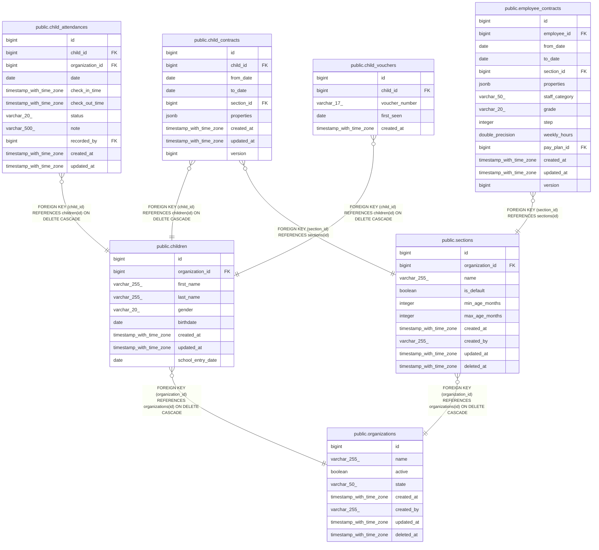

# public.child_contracts

## Columns

| Name       | Type                     | Default                                     | Nullable | Children | Parents                               | Comment |
| ---------- | ------------------------ | ------------------------------------------- | -------- | -------- | ------------------------------------- | ------- |
| id         | bigint                   | nextval('child_contracts_id_seq'::regclass) | false    |          |                                       |         |
| child_id   | bigint                   |                                             | false    |          | [public.children](public.children.md) |         |
| from_date  | date                     |                                             | false    |          |                                       |         |
| to_date    | date                     |                                             | true     |          |                                       |         |
| section_id | bigint                   |                                             | false    |          | [public.sections](public.sections.md) |         |
| properties | jsonb                    |                                             | true     |          |                                       |         |
| created_at | timestamp with time zone |                                             | true     |          |                                       |         |
| updated_at | timestamp with time zone |                                             | true     |          |                                       |         |
| version    | bigint                   | 1                                           | false    |          |                                       |         |

## Constraints

| Name                                | Type        | Definition                                                                                                                                              |
| ----------------------------------- | ----------- | ------------------------------------------------------------------------------------------------------------------------------------------------------- |
| child_contracts_child_id_not_null   | n           | NOT NULL child_id                                                                                                                                       |
| child_contracts_from_date_not_null  | n           | NOT NULL from_date                                                                                                                                      |
| child_contracts_id_not_null         | n           | NOT NULL id                                                                                                                                             |
| child_contracts_section_id_not_null | n           | NOT NULL section_id                                                                                                                                     |
| child_contracts_version_not_null    | n           | NOT NULL version                                                                                                                                        |
| child_contracts_section_id_fkey     | FOREIGN KEY | FOREIGN KEY (section_id) REFERENCES sections(id)                                                                                                        |
| child_contracts_child_id_fkey       | FOREIGN KEY | FOREIGN KEY (child_id) REFERENCES children(id) ON DELETE CASCADE                                                                                        |
| child_contracts_pkey                | PRIMARY KEY | PRIMARY KEY (id)                                                                                                                                        |
| child_contracts_no_overlap          | x           | EXCLUDE USING gist (child_id WITH =, daterange(from_date, COALESCE((to_date + 1), 'infinity'::date), '[)'::text) WITH &&) DEFERRABLE INITIALLY DEFERRED |

## Indexes

| Name                           | Definition                                                                                                                                                           |
| ------------------------------ | -------------------------------------------------------------------------------------------------------------------------------------------------------------------- |
| child_contracts_pkey           | CREATE UNIQUE INDEX child_contracts_pkey ON public.child_contracts USING btree (id)                                                                                  |
| idx_child_contracts_child_id   | CREATE INDEX idx_child_contracts_child_id ON public.child_contracts USING btree (child_id)                                                                           |
| idx_child_contracts_section_id | CREATE INDEX idx_child_contracts_section_id ON public.child_contracts USING btree (section_id)                                                                       |
| idx_child_contracts_period     | CREATE INDEX idx_child_contracts_period ON public.child_contracts USING btree (child_id, from_date, to_date)                                                         |
| child_contracts_no_overlap     | CREATE INDEX child_contracts_no_overlap ON public.child_contracts USING gist (child_id, daterange(from_date, COALESCE((to_date + 1), 'infinity'::date), '[)'::text)) |

## Relations

---

> Generated by [tbls](https://github.com/k1LoW/tbls)
