# public.children

## Columns

| Name              | Type                     | Default                              | Nullable | Children                                                                                                                                                      | Parents                                         | Comment |
| ----------------- | ------------------------ | ------------------------------------ | -------- | ------------------------------------------------------------------------------------------------------------------------------------------------------------- | ----------------------------------------------- | ------- |
| id                | bigint                   | nextval('children_id_seq'::regclass) | false    | [public.child_contracts](public.child_contracts.md) [public.child_attendances](public.child_attendances.md) [public.child_vouchers](public.child_vouchers.md) |                                                 |         |
| organization_id   | bigint                   |                                      | false    |                                                                                                                                                               | [public.organizations](public.organizations.md) |         |
| first_name        | varchar(255)             |                                      | false    |                                                                                                                                                               |                                                 |         |
| last_name         | varchar(255)             |                                      | false    |                                                                                                                                                               |                                                 |         |
| gender            | varchar(20)              |                                      | false    |                                                                                                                                                               |                                                 |         |
| birthdate         | date                     |                                      | false    |                                                                                                                                                               |                                                 |         |
| created_at        | timestamp with time zone |                                      | true     |                                                                                                                                                               |                                                 |         |
| updated_at        | timestamp with time zone |                                      | true     |                                                                                                                                                               |                                                 |         |
| school_entry_date | date                     |                                      | true     |                                                                                                                                                               |                                                 |         |

## Constraints

| Name                              | Type        | Definition                                                                   |
| --------------------------------- | ----------- | ---------------------------------------------------------------------------- |
| children_birthdate_not_null       | n           | NOT NULL birthdate                                                           |
| children_first_name_not_null      | n           | NOT NULL first_name                                                          |
| children_gender_not_null          | n           | NOT NULL gender                                                              |
| children_id_not_null              | n           | NOT NULL id                                                                  |
| children_last_name_not_null       | n           | NOT NULL last_name                                                           |
| children_organization_id_not_null | n           | NOT NULL organization_id                                                     |
| children_organization_id_fkey     | FOREIGN KEY | FOREIGN KEY (organization_id) REFERENCES organizations(id) ON DELETE CASCADE |
| children_pkey                     | PRIMARY KEY | PRIMARY KEY (id)                                                             |

## Indexes

| Name                         | Definition                                                                                 |
| ---------------------------- | ------------------------------------------------------------------------------------------ |
| children_pkey                | CREATE UNIQUE INDEX children_pkey ON public.children USING btree (id)                      |
| idx_children_organization_id | CREATE INDEX idx_children_organization_id ON public.children USING btree (organization_id) |

## Relations

```mermaid
erDiagram

"public.child_contracts" }o--|| "public.children" : "FOREIGN KEY (child_id) REFERENCES children(id) ON DELETE CASCADE"
"public.child_contracts" }o--|| "public.sections" : "FOREIGN KEY (section_id) REFERENCES sections(id)"
"public.child_attendances" }o--|| "public.children" : "FOREIGN KEY (child_id) REFERENCES children(id) ON DELETE CASCADE"
"public.child_attendances" }o--|| "public.organizations" : "FOREIGN KEY (organization_id) REFERENCES organizations(id) ON DELETE CASCADE"
"public.child_attendances" }o--o| "public.users" : "FOREIGN KEY (recorded_by) REFERENCES users(id) ON DELETE SET NULL"
"public.child_vouchers" }o--|| "public.children" : "FOREIGN KEY (child_id) REFERENCES children(id) ON DELETE CASCADE"
"public.children" }o--|| "public.organizations" : "FOREIGN KEY (organization_id) REFERENCES organizations(id) ON DELETE CASCADE"
"public.user_organizations" }o--|| "public.organizations" : "FOREIGN KEY (organization_id) REFERENCES organizations(id) ON DELETE CASCADE"
"public.sections" }o--|| "public.organizations" : "FOREIGN KEY (organization_id) REFERENCES organizations(id) ON DELETE CASCADE"
"public.employees" }o--|| "public.organizations" : "FOREIGN KEY (organization_id) REFERENCES organizations(id) ON DELETE CASCADE"
"public.pay_plans" }o--|| "public.organizations" : "FOREIGN KEY (organization_id) REFERENCES organizations(id) ON DELETE CASCADE"
"public.budget_items" }o--|| "public.organizations" : "FOREIGN KEY (organization_id) REFERENCES organizations(id) ON DELETE CASCADE"
"public.audit_logs" }o--o| "public.organizations" : "FOREIGN KEY (organization_id) REFERENCES organizations(id) ON DELETE SET NULL"
"public.government_funding_bill_periods" }o--|| "public.organizations" : "FOREIGN KEY (organization_id) REFERENCES organizations(id) ON DELETE CASCADE"

"public.children" {
  bigint id
  bigint organization_id FK
  varchar_255_ first_name
  varchar_255_ last_name
  varchar_20_ gender
  date birthdate
  timestamp_with_time_zone created_at
  timestamp_with_time_zone updated_at
  date school_entry_date
}
"public.child_contracts" {
  bigint id
  bigint child_id FK
  date from_date
  date to_date
  bigint section_id FK
  jsonb properties
  timestamp_with_time_zone created_at
  timestamp_with_time_zone updated_at
  bigint version
}
"public.sections" {
  bigint id
  bigint organization_id FK
  varchar_255_ name
  boolean is_default
  integer min_age_months
  integer max_age_months
  timestamp_with_time_zone created_at
  varchar_255_ created_by
  timestamp_with_time_zone updated_at
  timestamp_with_time_zone deleted_at
}
"public.child_attendances" {
  bigint id
  bigint child_id FK
  bigint organization_id FK
  date date
  timestamp_with_time_zone check_in_time
  timestamp_with_time_zone check_out_time
  varchar_20_ status
  varchar_500_ note
  bigint recorded_by FK
  timestamp_with_time_zone created_at
  timestamp_with_time_zone updated_at
}
"public.organizations" {
  bigint id
  varchar_255_ name
  boolean active
  varchar_50_ state
  timestamp_with_time_zone created_at
  varchar_255_ created_by
  timestamp_with_time_zone updated_at
  timestamp_with_time_zone deleted_at
}
"public.users" {
  bigint id
  varchar_255_ name
  varchar_255_ email
  varchar_255_ password
  boolean active
  boolean is_superadmin
  timestamp_with_time_zone last_login
  timestamp_with_time_zone created_at
  varchar_255_ created_by
  timestamp_with_time_zone updated_at
  timestamp_with_time_zone deleted_at
}
"public.child_vouchers" {
  bigint id
  bigint child_id FK
  varchar_17_ voucher_number
  date first_seen
  timestamp_with_time_zone created_at
}
"public.user_organizations" {
  bigint user_id FK
  bigint organization_id FK
  varchar_50_ role
  timestamp_with_time_zone created_at
  varchar_255_ created_by
}
"public.employees" {
  bigint id
  bigint organization_id FK
  varchar_255_ first_name
  varchar_255_ last_name
  varchar_20_ gender
  date birthdate
  timestamp_with_time_zone created_at
  timestamp_with_time_zone updated_at
}
"public.pay_plans" {
  bigint id
  bigint organization_id FK
  text name
  timestamp_with_time_zone created_at
  timestamp_with_time_zone updated_at
}
"public.budget_items" {
  bigint id
  bigint organization_id FK
  varchar_255_ name
  varchar_50_ category
  boolean per_child
  timestamp_with_time_zone created_at
  timestamp_with_time_zone updated_at
}
"public.audit_logs" {
  bigint id
  timestamp_with_time_zone timestamp
  bigint user_id
  varchar_255_ user_email
  varchar_100_ action
  varchar_100_ resource_type
  bigint resource_id
  varchar_45_ ip_address
  varchar_512_ user_agent
  text details
  boolean success
  bigint organization_id FK
  varchar_64_ request_id
}
"public.government_funding_bill_periods" {
  bigint id
  bigint organization_id FK
  date from_date
  date to_date
  varchar_255_ file_name
  varchar_64_ file_sha256
  varchar_255_ facility_name
  integer facility_total
  integer contract_booking
  integer correction_booking
  bigint created_by FK
  timestamp_with_time_zone created_at
  timestamp_with_time_zone updated_at
  date correction_booking_from_month
  date correction_booking_to_month
  varchar_64_ correction_booking_reason
}
```

---

> Generated by [tbls](https://github.com/k1LoW/tbls)
