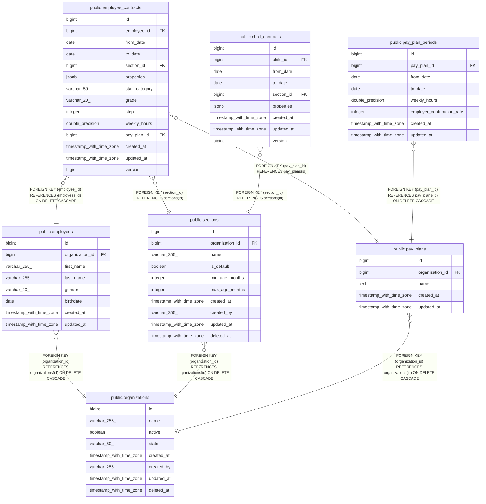

# public.employee_contracts

## Columns

| Name           | Type                     | Default                                        | Nullable | Children | Parents                                 | Comment |
| -------------- | ------------------------ | ---------------------------------------------- | -------- | -------- | --------------------------------------- | ------- |
| id             | bigint                   | nextval('employee_contracts_id_seq'::regclass) | false    |          |                                         |         |
| employee_id    | bigint                   |                                                | false    |          | [public.employees](public.employees.md) |         |
| from_date      | date                     |                                                | false    |          |                                         |         |
| to_date        | date                     |                                                | true     |          |                                         |         |
| section_id     | bigint                   |                                                | false    |          | [public.sections](public.sections.md)   |         |
| properties     | jsonb                    |                                                | true     |          |                                         |         |
| staff_category | varchar(50)              | 'qualified'::character varying                 | false    |          |                                         |         |
| grade          | varchar(20)              |                                                | true     |          |                                         |         |
| step           | integer                  |                                                | true     |          |                                         |         |
| weekly_hours   | double precision         |                                                | true     |          |                                         |         |
| pay_plan_id    | bigint                   |                                                | false    |          | [public.pay_plans](public.pay_plans.md) |         |
| created_at     | timestamp with time zone |                                                | true     |          |                                         |         |
| updated_at     | timestamp with time zone |                                                | true     |          |                                         |         |
| version        | bigint                   | 1                                              | false    |          |                                         |         |

## Constraints

| Name                                       | Type        | Definition                                                                                                                                                         |
| ------------------------------------------ | ----------- | ------------------------------------------------------------------------------------------------------------------------------------------------------------------ |
| employee_contracts_employee_id_not_null    | n           | NOT NULL employee_id                                                                                                                                               |
| employee_contracts_from_date_not_null      | n           | NOT NULL from_date                                                                                                                                                 |
| employee_contracts_id_not_null             | n           | NOT NULL id                                                                                                                                                        |
| employee_contracts_pay_plan_id_not_null    | n           | NOT NULL pay_plan_id                                                                                                                                               |
| employee_contracts_section_id_not_null     | n           | NOT NULL section_id                                                                                                                                                |
| employee_contracts_staff_category_not_null | n           | NOT NULL staff_category                                                                                                                                            |
| employee_contracts_staff_category_valid    | CHECK       | CHECK (((staff_category)::text = ANY ((ARRAY['qualified'::character varying, 'supplementary'::character varying, 'non_pedagogical'::character varying])::text[]))) |
| employee_contracts_step_valid              | CHECK       | CHECK (((step IS NULL) OR ((step >= 0) AND (step <= 10))))                                                                                                         |
| employee_contracts_version_not_null        | n           | NOT NULL version                                                                                                                                                   |
| employee_contracts_weekly_hours_valid      | CHECK       | CHECK (((weekly_hours IS NULL) OR ((weekly_hours >= (0)::double precision) AND (weekly_hours <= (168)::double precision))))                                        |
| employee_contracts_section_id_fkey         | FOREIGN KEY | FOREIGN KEY (section_id) REFERENCES sections(id)                                                                                                                   |
| employee_contracts_employee_id_fkey        | FOREIGN KEY | FOREIGN KEY (employee_id) REFERENCES employees(id) ON DELETE CASCADE                                                                                               |
| employee_contracts_pay_plan_id_fkey        | FOREIGN KEY | FOREIGN KEY (pay_plan_id) REFERENCES pay_plans(id)                                                                                                                 |
| employee_contracts_pkey                    | PRIMARY KEY | PRIMARY KEY (id)                                                                                                                                                   |
| employee_contracts_no_overlap              | x           | EXCLUDE USING gist (employee_id WITH =, daterange(from_date, COALESCE((to_date + 1), 'infinity'::date), '[)'::text) WITH &&) DEFERRABLE INITIALLY DEFERRED         |

## Indexes

| Name                               | Definition                                                                                                                                                                    |
| ---------------------------------- | ----------------------------------------------------------------------------------------------------------------------------------------------------------------------------- |
| employee_contracts_pkey            | CREATE UNIQUE INDEX employee_contracts_pkey ON public.employee_contracts USING btree (id)                                                                                     |
| idx_employee_contracts_employee_id | CREATE INDEX idx_employee_contracts_employee_id ON public.employee_contracts USING btree (employee_id)                                                                        |
| idx_employee_contracts_section_id  | CREATE INDEX idx_employee_contracts_section_id ON public.employee_contracts USING btree (section_id)                                                                          |
| idx_employee_contracts_pay_plan_id | CREATE INDEX idx_employee_contracts_pay_plan_id ON public.employee_contracts USING btree (pay_plan_id)                                                                        |
| idx_employee_contracts_period      | CREATE INDEX idx_employee_contracts_period ON public.employee_contracts USING btree (employee_id, from_date, to_date)                                                         |
| employee_contracts_no_overlap      | CREATE INDEX employee_contracts_no_overlap ON public.employee_contracts USING gist (employee_id, daterange(from_date, COALESCE((to_date + 1), 'infinity'::date), '[)'::text)) |

## Relations

---

> Generated by [tbls](https://github.com/k1LoW/tbls)
