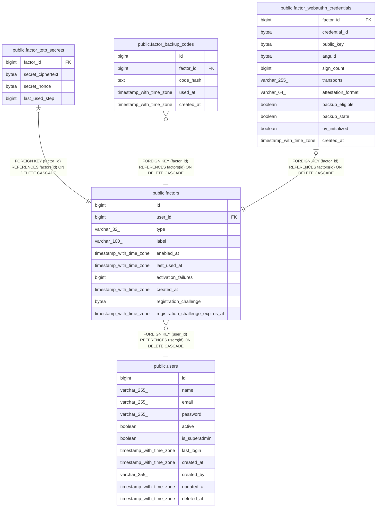

# public.factor_totp_secrets

## Columns

| Name              | Type   | Default | Nullable | Children | Parents                             | Comment |
| ----------------- | ------ | ------- | -------- | -------- | ----------------------------------- | ------- |
| factor_id         | bigint |         | false    |          | [public.factors](public.factors.md) |         |
| secret_ciphertext | bytea  |         | false    |          |                                     |         |
| secret_nonce      | bytea  |         | false    |          |                                     |         |
| last_used_step    | bigint |         | true     |          |                                     |         |

## Constraints

| Name                                           | Type        | Definition                                                       |
| ---------------------------------------------- | ----------- | ---------------------------------------------------------------- |
| factor_totp_secrets_factor_id_not_null         | n           | NOT NULL factor_id                                               |
| factor_totp_secrets_secret_ciphertext_not_null | n           | NOT NULL secret_ciphertext                                       |
| factor_totp_secrets_secret_nonce_not_null      | n           | NOT NULL secret_nonce                                            |
| factor_totp_secrets_factor_id_fkey             | FOREIGN KEY | FOREIGN KEY (factor_id) REFERENCES factors(id) ON DELETE CASCADE |
| factor_totp_secrets_pkey                       | PRIMARY KEY | PRIMARY KEY (factor_id)                                          |

## Indexes

| Name                     | Definition                                                                                         |
| ------------------------ | -------------------------------------------------------------------------------------------------- |
| factor_totp_secrets_pkey | CREATE UNIQUE INDEX factor_totp_secrets_pkey ON public.factor_totp_secrets USING btree (factor_id) |

## Relations

---

> Generated by [tbls](https://github.com/k1LoW/tbls)
