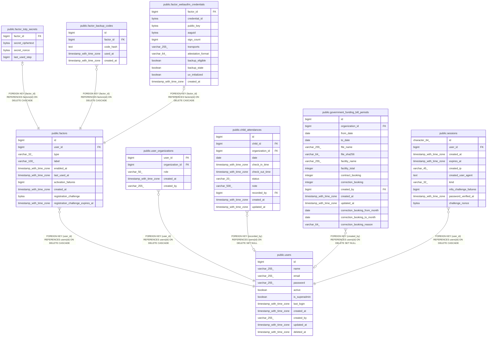

# public.factors

## Columns

| Name                              | Type                     | Default                             | Nullable | Children                                                                                                                                                                                            | Parents                         | Comment |
| --------------------------------- | ------------------------ | ----------------------------------- | -------- | --------------------------------------------------------------------------------------------------------------------------------------------------------------------------------------------------- | ------------------------------- | ------- |
| id                                | bigint                   | nextval('factors_id_seq'::regclass) | false    | [public.factor_totp_secrets](public.factor_totp_secrets.md) [public.factor_backup_codes](public.factor_backup_codes.md) [public.factor_webauthn_credentials](public.factor_webauthn_credentials.md) |                                 |         |
| user_id                           | bigint                   |                                     | false    |                                                                                                                                                                                                     | [public.users](public.users.md) |         |
| type                              | varchar(32)              |                                     | false    |                                                                                                                                                                                                     |                                 |         |
| label                             | varchar(100)             |                                     | true     |                                                                                                                                                                                                     |                                 |         |
| enabled_at                        | timestamp with time zone |                                     | true     |                                                                                                                                                                                                     |                                 |         |
| last_used_at                      | timestamp with time zone |                                     | true     |                                                                                                                                                                                                     |                                 |         |
| activation_failures               | bigint                   | 0                                   | false    |                                                                                                                                                                                                     |                                 |         |
| created_at                        | timestamp with time zone |                                     | false    |                                                                                                                                                                                                     |                                 |         |
| registration_challenge            | bytea                    |                                     | true     |                                                                                                                                                                                                     |                                 |         |
| registration_challenge_expires_at | timestamp with time zone |                                     | true     |                                                                                                                                                                                                     |                                 |         |

## Constraints

| Name                                 | Type        | Definition                                                                                                                                  |
| ------------------------------------ | ----------- | ------------------------------------------------------------------------------------------------------------------------------------------- |
| factors_activation_failures_not_null | n           | NOT NULL activation_failures                                                                                                                |
| factors_created_at_not_null          | n           | NOT NULL created_at                                                                                                                         |
| factors_id_not_null                  | n           | NOT NULL id                                                                                                                                 |
| factors_type_check                   | CHECK       | CHECK (((type)::text = ANY ((ARRAY['totp'::character varying, 'backup_codes'::character varying, 'webauthn'::character varying])::text[]))) |
| factors_type_not_null                | n           | NOT NULL type                                                                                                                               |
| factors_user_id_not_null             | n           | NOT NULL user_id                                                                                                                            |
| factors_user_id_fkey                 | FOREIGN KEY | FOREIGN KEY (user_id) REFERENCES users(id) ON DELETE CASCADE                                                                                |
| factors_pkey                         | PRIMARY KEY | PRIMARY KEY (id)                                                                                                                            |

## Indexes

| Name                              | Definition                                                                                                                                |
| --------------------------------- | ----------------------------------------------------------------------------------------------------------------------------------------- |
| factors_pkey                      | CREATE UNIQUE INDEX factors_pkey ON public.factors USING btree (id)                                                                       |
| idx_factors_user_id               | CREATE INDEX idx_factors_user_id ON public.factors USING btree (user_id)                                                                  |
| idx_factors_user_enabled          | CREATE INDEX idx_factors_user_enabled ON public.factors USING btree (user_id, enabled_at) WHERE (enabled_at IS NOT NULL)                  |
| idx_factors_user_singleton_backup | CREATE UNIQUE INDEX idx_factors_user_singleton_backup ON public.factors USING btree (user_id) WHERE ((type)::text = 'backup_codes'::text) |

## Relations

---

> Generated by [tbls](https://github.com/k1LoW/tbls)
