# public.organizations

## Columns

| Name       | Type                     | Default                                   | Nullable | Children                                                                                                                                                                                                                                                                                                                                                                                                                                                  | Parents | Comment |
| ---------- | ------------------------ | ----------------------------------------- | -------- | --------------------------------------------------------------------------------------------------------------------------------------------------------------------------------------------------------------------------------------------------------------------------------------------------------------------------------------------------------------------------------------------------------------------------------------------------------- | ------- | ------- |
| id         | bigint                   | nextval('organizations_id_seq'::regclass) | false    | [public.user_organizations](public.user_organizations.md) [public.sections](public.sections.md) [public.employees](public.employees.md) [public.pay_plans](public.pay_plans.md) [public.children](public.children.md) [public.child_attendances](public.child_attendances.md) [public.budget_items](public.budget_items.md) [public.audit_logs](public.audit_logs.md) [public.government_funding_bill_periods](public.government_funding_bill_periods.md) |         |         |
| name       | varchar(255)             |                                           | false    |                                                                                                                                                                                                                                                                                                                                                                                                                                                           |         |         |
| active     | boolean                  | true                                      | true     |                                                                                                                                                                                                                                                                                                                                                                                                                                                           |         |         |
| state      | varchar(50)              | 'berlin'::character varying               | false    |                                                                                                                                                                                                                                                                                                                                                                                                                                                           |         |         |
| created_at | timestamp with time zone |                                           | true     |                                                                                                                                                                                                                                                                                                                                                                                                                                                           |         |         |
| created_by | varchar(255)             |                                           | true     |                                                                                                                                                                                                                                                                                                                                                                                                                                                           |         |         |
| updated_at | timestamp with time zone |                                           | true     |                                                                                                                                                                                                                                                                                                                                                                                                                                                           |         |         |
| deleted_at | timestamp with time zone |                                           | true     |                                                                                                                                                                                                                                                                                                                                                                                                                                                           |         |         |

## Constraints

| Name                         | Type        | Definition       |
| ---------------------------- | ----------- | ---------------- |
| organizations_id_not_null    | n           | NOT NULL id      |
| organizations_name_not_null  | n           | NOT NULL name    |
| organizations_state_not_null | n           | NOT NULL state   |
| organizations_pkey           | PRIMARY KEY | PRIMARY KEY (id) |

## Indexes

| Name                         | Definition                                                                                                                |
| ---------------------------- | ------------------------------------------------------------------------------------------------------------------------- |
| organizations_pkey           | CREATE UNIQUE INDEX organizations_pkey ON public.organizations USING btree (id)                                           |
| idx_organizations_deleted_at | CREATE INDEX idx_organizations_deleted_at ON public.organizations USING btree (deleted_at) WHERE (deleted_at IS NOT NULL) |
| idx_organizations_name       | CREATE UNIQUE INDEX idx_organizations_name ON public.organizations USING btree (name) WHERE (deleted_at IS NULL)          |

## Relations

```mermaid
erDiagram

"public.user_organizations" }o--|| "public.organizations" : "FOREIGN KEY (organization_id) REFERENCES organizations(id) ON DELETE CASCADE"
"public.user_organizations" }o--|| "public.users" : "FOREIGN KEY (user_id) REFERENCES users(id) ON DELETE CASCADE"
"public.sections" }o--|| "public.organizations" : "FOREIGN KEY (organization_id) REFERENCES organizations(id) ON DELETE CASCADE"
"public.employee_contracts" }o--|| "public.sections" : "FOREIGN KEY (section_id) REFERENCES sections(id)"
"public.child_contracts" }o--|| "public.sections" : "FOREIGN KEY (section_id) REFERENCES sections(id)"
"public.employees" }o--|| "public.organizations" : "FOREIGN KEY (organization_id) REFERENCES organizations(id) ON DELETE CASCADE"
"public.employee_contracts" }o--|| "public.employees" : "FOREIGN KEY (employee_id) REFERENCES employees(id) ON DELETE CASCADE"
"public.pay_plans" }o--|| "public.organizations" : "FOREIGN KEY (organization_id) REFERENCES organizations(id) ON DELETE CASCADE"
"public.pay_plan_periods" }o--|| "public.pay_plans" : "FOREIGN KEY (pay_plan_id) REFERENCES pay_plans(id) ON DELETE CASCADE"
"public.employee_contracts" }o--|| "public.pay_plans" : "FOREIGN KEY (pay_plan_id) REFERENCES pay_plans(id)"
"public.children" }o--|| "public.organizations" : "FOREIGN KEY (organization_id) REFERENCES organizations(id) ON DELETE CASCADE"
"public.child_contracts" }o--|| "public.children" : "FOREIGN KEY (child_id) REFERENCES children(id) ON DELETE CASCADE"
"public.child_attendances" }o--|| "public.children" : "FOREIGN KEY (child_id) REFERENCES children(id) ON DELETE CASCADE"
"public.child_vouchers" }o--|| "public.children" : "FOREIGN KEY (child_id) REFERENCES children(id) ON DELETE CASCADE"
"public.child_attendances" }o--|| "public.organizations" : "FOREIGN KEY (organization_id) REFERENCES organizations(id) ON DELETE CASCADE"
"public.child_attendances" }o--o| "public.users" : "FOREIGN KEY (recorded_by) REFERENCES users(id) ON DELETE SET NULL"
"public.budget_items" }o--|| "public.organizations" : "FOREIGN KEY (organization_id) REFERENCES organizations(id) ON DELETE CASCADE"
"public.budget_item_entries" }o--|| "public.budget_items" : "FOREIGN KEY (budget_item_id) REFERENCES budget_items(id) ON DELETE CASCADE"
"public.audit_logs" }o--o| "public.organizations" : "FOREIGN KEY (organization_id) REFERENCES organizations(id) ON DELETE SET NULL"
"public.government_funding_bill_periods" }o--|| "public.organizations" : "FOREIGN KEY (organization_id) REFERENCES organizations(id) ON DELETE CASCADE"
"public.government_funding_bill_children" }o--|| "public.government_funding_bill_periods" : "FOREIGN KEY (period_id) REFERENCES government_funding_bill_periods(id) ON DELETE CASCADE"
"public.government_funding_bill_periods" }o--o| "public.users" : "FOREIGN KEY (created_by) REFERENCES users(id) ON DELETE SET NULL"

"public.organizations" {
  bigint id
  varchar_255_ name
  boolean active
  varchar_50_ state
  timestamp_with_time_zone created_at
  varchar_255_ created_by
  timestamp_with_time_zone updated_at
  timestamp_with_time_zone deleted_at
}
"public.user_organizations" {
  bigint user_id FK
  bigint organization_id FK
  varchar_50_ role
  timestamp_with_time_zone created_at
  varchar_255_ created_by
}
"public.users" {
  bigint id
  varchar_255_ name
  varchar_255_ email
  varchar_255_ password
  boolean active
  boolean is_superadmin
  timestamp_with_time_zone last_login
  timestamp_with_time_zone created_at
  varchar_255_ created_by
  timestamp_with_time_zone updated_at
  timestamp_with_time_zone deleted_at
}
"public.sections" {
  bigint id
  bigint organization_id FK
  varchar_255_ name
  boolean is_default
  integer min_age_months
  integer max_age_months
  timestamp_with_time_zone created_at
  varchar_255_ created_by
  timestamp_with_time_zone updated_at
  timestamp_with_time_zone deleted_at
}
"public.employee_contracts" {
  bigint id
  bigint employee_id FK
  date from_date
  date to_date
  bigint section_id FK
  jsonb properties
  varchar_50_ staff_category
  varchar_20_ grade
  integer step
  double_precision weekly_hours
  bigint pay_plan_id FK
  timestamp_with_time_zone created_at
  timestamp_with_time_zone updated_at
  bigint version
}
"public.child_contracts" {
  bigint id
  bigint child_id FK
  date from_date
  date to_date
  bigint section_id FK
  jsonb properties
  timestamp_with_time_zone created_at
  timestamp_with_time_zone updated_at
  bigint version
}
"public.employees" {
  bigint id
  bigint organization_id FK
  varchar_255_ first_name
  varchar_255_ last_name
  varchar_20_ gender
  date birthdate
  timestamp_with_time_zone created_at
  timestamp_with_time_zone updated_at
}
"public.pay_plans" {
  bigint id
  bigint organization_id FK
  text name
  timestamp_with_time_zone created_at
  timestamp_with_time_zone updated_at
}
"public.pay_plan_periods" {
  bigint id
  bigint pay_plan_id FK
  date from_date
  date to_date
  double_precision weekly_hours
  integer employer_contribution_rate
  timestamp_with_time_zone created_at
  timestamp_with_time_zone updated_at
}
"public.children" {
  bigint id
  bigint organization_id FK
  varchar_255_ first_name
  varchar_255_ last_name
  varchar_20_ gender
  date birthdate
  timestamp_with_time_zone created_at
  timestamp_with_time_zone updated_at
  date school_entry_date
}
"public.child_attendances" {
  bigint id
  bigint child_id FK
  bigint organization_id FK
  date date
  timestamp_with_time_zone check_in_time
  timestamp_with_time_zone check_out_time
  varchar_20_ status
  varchar_500_ note
  bigint recorded_by FK
  timestamp_with_time_zone created_at
  timestamp_with_time_zone updated_at
}
"public.child_vouchers" {
  bigint id
  bigint child_id FK
  varchar_17_ voucher_number
  date first_seen
  timestamp_with_time_zone created_at
}
"public.budget_items" {
  bigint id
  bigint organization_id FK
  varchar_255_ name
  varchar_50_ category
  boolean per_child
  timestamp_with_time_zone created_at
  timestamp_with_time_zone updated_at
}
"public.budget_item_entries" {
  bigint id
  bigint budget_item_id FK
  date from_date
  date to_date
  integer amount_cents
  varchar_500_ notes
  timestamp_with_time_zone created_at
  timestamp_with_time_zone updated_at
}
"public.audit_logs" {
  bigint id
  timestamp_with_time_zone timestamp
  bigint user_id
  varchar_255_ user_email
  varchar_100_ action
  varchar_100_ resource_type
  bigint resource_id
  varchar_45_ ip_address
  varchar_512_ user_agent
  text details
  boolean success
  bigint organization_id FK
  varchar_64_ request_id
}
"public.government_funding_bill_periods" {
  bigint id
  bigint organization_id FK
  date from_date
  date to_date
  varchar_255_ file_name
  varchar_64_ file_sha256
  varchar_255_ facility_name
  integer facility_total
  integer contract_booking
  integer correction_booking
  bigint created_by FK
  timestamp_with_time_zone created_at
  timestamp_with_time_zone updated_at
  date correction_booking_from_month
  date correction_booking_to_month
  varchar_64_ correction_booking_reason
}
"public.government_funding_bill_children" {
  bigint id
  bigint period_id FK
  varchar_20_ voucher_number
  varchar_255_ child_name
  varchar_10_ birth_date
  integer district
}
```

---

> Generated by [tbls](https://github.com/k1LoW/tbls)
