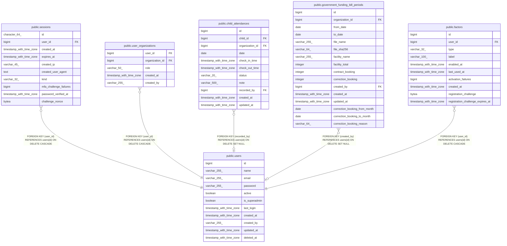

# public.sessions

## Columns

| Name                   | Type                     | Default                      | Nullable | Children | Parents                         | Comment |
| ---------------------- | ------------------------ | ---------------------------- | -------- | -------- | ------------------------------- | ------- |
| id                     | character(64)            |                              | false    |          |                                 |         |
| user_id                | bigint                   |                              | false    |          | [public.users](public.users.md) |         |
| created_at             | timestamp with time zone |                              | false    |          |                                 |         |
| expires_at             | timestamp with time zone |                              | false    |          |                                 |         |
| created_ip             | varchar(45)              |                              | true     |          |                                 |         |
| created_user_agent     | text                     |                              | true     |          |                                 |         |
| kind                   | varchar(32)              | 'regular'::character varying | false    |          |                                 |         |
| mfa_challenge_failures | bigint                   | 0                            | false    |          |                                 |         |
| password_verified_at   | timestamp with time zone |                              | true     |          |                                 |         |
| challenge_nonce        | bytea                    |                              | true     |          |                                 |         |

## Constraints

| Name                                     | Type        | Definition                                                                                                     |
| ---------------------------------------- | ----------- | -------------------------------------------------------------------------------------------------------------- |
| sessions_created_at_not_null             | n           | NOT NULL created_at                                                                                            |
| sessions_expires_at_not_null             | n           | NOT NULL expires_at                                                                                            |
| sessions_id_not_null                     | n           | NOT NULL id                                                                                                    |
| sessions_kind_check                      | CHECK       | CHECK (((kind)::text = ANY ((ARRAY['regular'::character varying, 'pending_mfa'::character varying])::text[]))) |
| sessions_kind_not_null                   | n           | NOT NULL kind                                                                                                  |
| sessions_mfa_challenge_failures_not_null | n           | NOT NULL mfa_challenge_failures                                                                                |
| sessions_user_id_not_null                | n           | NOT NULL user_id                                                                                               |
| sessions_user_id_fkey                    | FOREIGN KEY | FOREIGN KEY (user_id) REFERENCES users(id) ON DELETE CASCADE                                                   |
| sessions_pkey                            | PRIMARY KEY | PRIMARY KEY (id)                                                                                               |

## Indexes

| Name                      | Definition                                                                               |
| ------------------------- | ---------------------------------------------------------------------------------------- |
| sessions_pkey             | CREATE UNIQUE INDEX sessions_pkey ON public.sessions USING btree (id)                    |
| idx_sessions_user_id      | CREATE INDEX idx_sessions_user_id ON public.sessions USING btree (user_id)               |
| idx_sessions_expires_at   | CREATE INDEX idx_sessions_expires_at ON public.sessions USING btree (expires_at)         |
| idx_sessions_kind_expires | CREATE INDEX idx_sessions_kind_expires ON public.sessions USING btree (kind, expires_at) |

## Relations

---

> Generated by [tbls](https://github.com/k1LoW/tbls)
