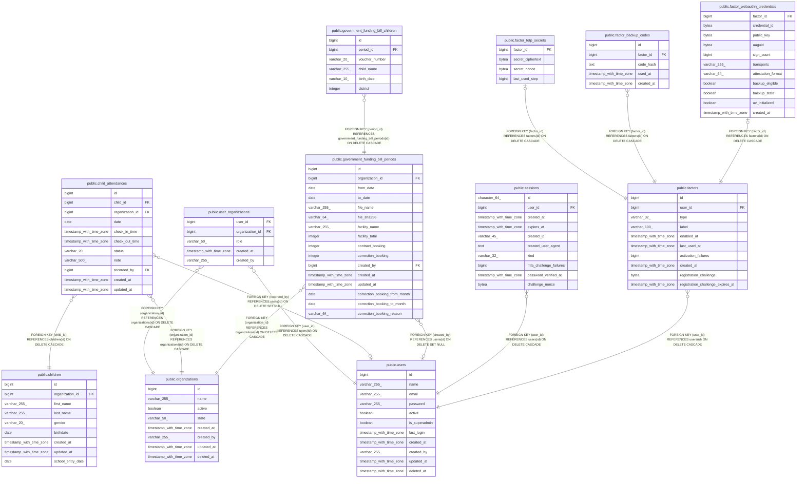

# public.users

## Columns

| Name          | Type                     | Default                           | Nullable | Children                                                                                                                                                                                                                                                                        | Parents | Comment |
| ------------- | ------------------------ | --------------------------------- | -------- | ------------------------------------------------------------------------------------------------------------------------------------------------------------------------------------------------------------------------------------------------------------------------------- | ------- | ------- |
| id            | bigint                   | nextval('users_id_seq'::regclass) | false    | [public.user_organizations](public.user_organizations.md) [public.child_attendances](public.child_attendances.md) [public.government_funding_bill_periods](public.government_funding_bill_periods.md) [public.sessions](public.sessions.md) [public.factors](public.factors.md) |         |         |
| name          | varchar(255)             |                                   | false    |                                                                                                                                                                                                                                                                                 |         |         |
| email         | varchar(255)             |                                   | false    |                                                                                                                                                                                                                                                                                 |         |         |
| password      | varchar(255)             |                                   | false    |                                                                                                                                                                                                                                                                                 |         |         |
| active        | boolean                  | true                              | true     |                                                                                                                                                                                                                                                                                 |         |         |
| is_superadmin | boolean                  | false                             | true     |                                                                                                                                                                                                                                                                                 |         |         |
| last_login    | timestamp with time zone |                                   | true     |                                                                                                                                                                                                                                                                                 |         |         |
| created_at    | timestamp with time zone |                                   | true     |                                                                                                                                                                                                                                                                                 |         |         |
| created_by    | varchar(255)             |                                   | true     |                                                                                                                                                                                                                                                                                 |         |         |
| updated_at    | timestamp with time zone |                                   | true     |                                                                                                                                                                                                                                                                                 |         |         |
| deleted_at    | timestamp with time zone |                                   | true     |                                                                                                                                                                                                                                                                                 |         |         |

## Constraints

| Name                    | Type        | Definition        |
| ----------------------- | ----------- | ----------------- |
| users_email_not_null    | n           | NOT NULL email    |
| users_id_not_null       | n           | NOT NULL id       |
| users_name_not_null     | n           | NOT NULL name     |
| users_password_not_null | n           | NOT NULL password |
| users_pkey              | PRIMARY KEY | PRIMARY KEY (id)  |

## Indexes

| Name                  | Definition                                                                                                              |
| --------------------- | ----------------------------------------------------------------------------------------------------------------------- |
| users_pkey            | CREATE UNIQUE INDEX users_pkey ON public.users USING btree (id)                                                         |
| idx_users_deleted_at  | CREATE INDEX idx_users_deleted_at ON public.users USING btree (deleted_at) WHERE (deleted_at IS NOT NULL)               |
| idx_users_email_lower | CREATE UNIQUE INDEX idx_users_email_lower ON public.users USING btree (lower((email)::text)) WHERE (deleted_at IS NULL) |

## Relations

---

> Generated by [tbls](https://github.com/k1LoW/tbls)
